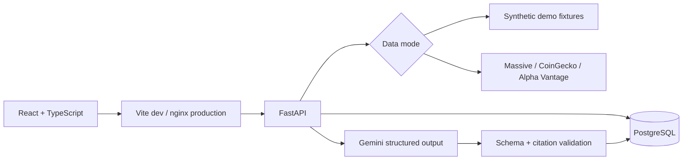

# Architecture

## Responsibilities

- `frontend/src/App.tsx`: overview, portfolio, watchlist, research catalog, search, holding editor, data settings.
- `frontend/src/AssetPage.tsx`: asset research, article previews, outlook generation and citation navigation.
- `frontend/src/Chart.tsx`: Lightweight Charts history with selectable periods and small SVG sparklines.
- `backend/main.py`: API routes, one-time workspace seeding, persistence and outlook cache lifecycle.
- `backend/app/providers.py`: live data adapters, normalization, caching, rate budgets and Gemini calls.
- `backend/app/portfolio.py`: Decimal-based valuation, cost basis and unrealized returns.
- `backend/app/schemas.py`: holding limits and validated, source-linked outlook structures.
- `backend/migrations/`: Alembic database migrations. The app never silently creates tables at startup.

## Data flow

The browser calls only its own `/api` origin. FastAPI loads holdings and watchlists from PostgreSQL, retrieves quotes through the selected provider mode, and calculates portfolio totals. A missing holding quote hides total value and total return; it never treats an unavailable asset as worth zero. Cost basis remains available. Returns exclude fees, dividends, realized gains, and transaction history. Holdings are aggregate quantities and average purchase prices, not brokerage trades.

A live outlook uses recent article titles and summaries from the news adapter. Massive is the default news source; Alpha Vantage is an optional alternative. Crypto evidence is filtered for explicit asset-name mentions in a bounded shared news feed. Gemini is instructed to treat source content as untrusted evidence, to acknowledge uncertainty, and to cite only supplied IDs. Pydantic validates every narrative section and citation. Incomplete, malformed, or unreferenced outputs are rejected. The accepted result is stored with its exact source snapshot and model identifier. There is no automatic regeneration or background polling.

## Persistence

| Table | Key | Stores |
| --- | --- | --- |
| `workspaces` | mode | Whether that workspace has been initialized |
| `holdings` | mode + asset | Decimal quantity and average cost |
| `watch_items` | mode + asset | Saved research assets |
| `outlooks` | mode + asset | Generated timestamp, validated result, source snapshot |

The workspace marker prevents removed demo holdings from being reseeded. Live and demo data remain separate. Database constraints enforce positive quantity and nonnegative cost; API validation additionally rejects nonfinite values and excessive precision.

## Deliberate V1 boundaries

One local user, one portfolio per mode, 16 supported assets, USD values, daily historical charts, and on-demand outlook generation. There is no authentication, transaction ledger, trading, confidence score, price prediction, streaming quote feed, or automatic article scraping. The market/news cache and quota counters are in memory; outlooks and portfolio changes survive restarts. Locks coalesce provider calls and serialize same-asset generation within the single API process.

The sample mode is a complete functional demo with synthetic evidence. It does not claim actual market performance or live AI output. Optional live adapters use backend-only keys and expose provider failures explicitly.

## Checks and known limits

Automated tests cover financial rounding, incomplete valuations, input validation, unsafe/stale/duplicate news filtering, unknown citations, truncated model responses, caches/rate budgets, persistence, empty-state preservation, workspace isolation, and cross-origin writes. Provider calls are mocked in automated tests; real credentials are needed for live account verification.

Citation validation establishes that a source was supplied, not that the model's interpretation is correct. Free data allowances can limit a first load with many uncached assets. Market timestamps and source publication dates are shown so users can assess freshness.
